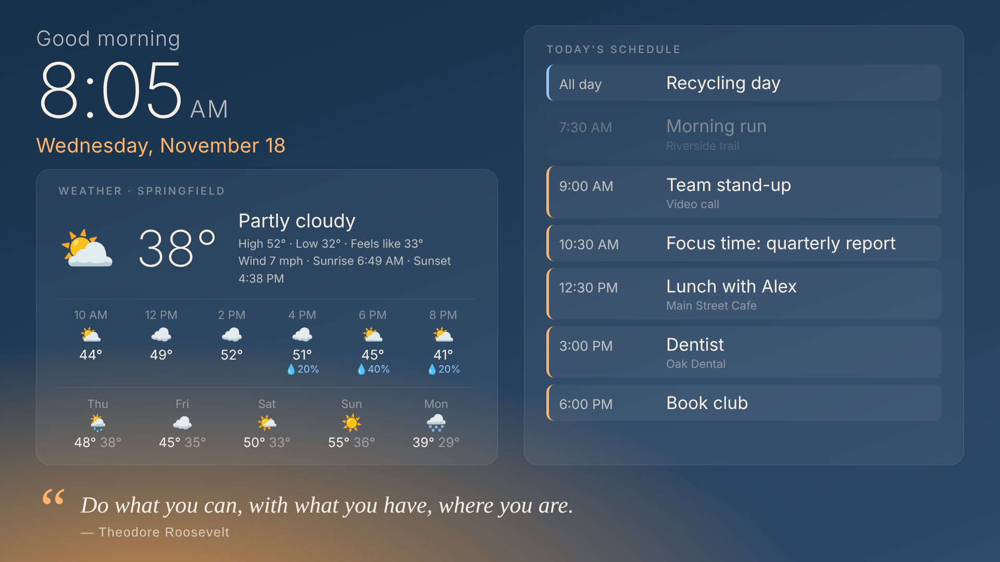

# Morning TV Dashboard

Turn your TV into a calm morning screen. Every morning at a time you choose, your Windows PC turns on your Roku TV, switches it to the PC, and shows:

- **The time and date**, with a background that shifts color through the day
- **Today's weather**: current conditions, the next 12 hours and a 5-day forecast
- **Your schedule** for today (and a peek at tomorrow) from your calendar
- **An inspirational quote** that changes every hour
- **An optional spoken news briefing**: press **Ctrl + Alt + N** and an AI-written summary of the day's national, world, tech and (when it matters) local news appears on screen and is read aloud through the TV

When the morning is over, the TV turns itself off and your PC goes back to normal.


*Sample data. Your city, calendar and quote will differ.*

This is **not** a website or online service. You download it and run your own copy on your own PC. Nothing is sent anywhere except the requests needed to fetch your weather, your calendar and (if you turn it on) your news briefing.

---

## What you need

- **A Windows 10 or Windows 11 PC** that can stay plugged in near the TV
- **Microsoft Edge** (already included with Windows)
- **A Roku TV or Roku-powered TV** (TCL, Hisense, Sharp, Philips and other brands sell these) on the **same Wi-Fi** as the PC
- **An HDMI cable** from the PC to the TV
- On the TV (Home button > **Settings**):
  - **System > Advanced system settings > Control by mobile apps**: set to **Enabled** (this lets the PC turn the TV on and switch inputs)
  - **System > Power > Fast TV start**: turn **on** (keeps the TV listening for the PC while it's off; uses a little more standby power)
  - Optional: **System > Control other devices (CEC) > 1-touch play**: turn on

Optional extras:

- A **calendar** that can give you a private iCal link (Google Calendar, Outlook.com, iCloud and most others can)
- A **Claude Console account** with an API key, for the spoken news briefing (you pay for your own usage; see below)

---

## Install

1. **Download:** on this project's GitHub page, click the green **Code** button, then **Download ZIP**.
2. **Unblock the ZIP (recommended):** right-click the downloaded ZIP > **Properties** > tick **Unblock** at the bottom > **OK**. This stops Windows from warning you about every file.
3. **Unzip it** somewhere you'll keep it, for example `Documents\MorningDashboard`. The dashboard runs from this folder, so don't delete it afterwards.
4. **Turn the TV on** and plug the PC into it with the HDMI cable.
5. **Run the installer:** double-click **install.bat**. If Windows asks "Do you want to run this file?", click **Run**.
6. Answer the questions. The installer will:
   - find your Roku TV automatically (or let you type its IP address, shown on the TV under **Settings > Network > About**)
   - ask which **HDMI input** the PC is plugged into (it's printed next to the port on the TV)
   - look up your **city** for the weather
   - briefly show the PC on the TV to find the **TV's speakers**
   - ask what **time** the TV should turn on, for how many hours, and whether every day or weekdays only
   - optionally save your **calendar link** and **Claude API key**
   - ask for **administrator permission once**, so Windows is allowed to wake the PC from sleep in the morning
   - offer to open **Sign-in options**, so Windows doesn't stop at the lock screen in the morning (see below)
7. At the end, let it **run the 1-minute test**: the TV should turn on and show the dashboard, then everything goes back to normal.

### About PowerShell's "execution policy"

The dashboard is a set of PowerShell scripts. Windows blocks scripts by default, so **install.bat** (and the schedule and shortcuts it creates) start PowerShell with `-ExecutionPolicy Bypass` for these scripts only; your system-wide setting is not changed.

If you'd rather run the installer from PowerShell yourself, open PowerShell in the dashboard folder (Shift + right-click inside the folder > **Open PowerShell window here**, or **Open in Terminal**) and run:

```powershell
Set-ExecutionPolicy -Scope Process -ExecutionPolicy Bypass
.\install.ps1
```

The first line only applies to that one PowerShell window.

### Two Windows settings that make the morning start work

**1. Don't ask for a sign-in after sleep.** If Windows shows its lock screen when it wakes up, the dashboard can't take over the screen until you sign in, so the TV won't show it on its own. (The TV still turns on, which is confusing.) To fix it:

1. Open **Settings** (Windows key + I) > **Accounts** > **Sign-in options**.
2. Under **Additional settings**, set **"If you've been away, when should Windows require you to sign in again?"** to **Never**.
3. If that option is greyed out, first turn off **"For improved security, only allow Windows Hello sign-in for Microsoft accounts on this device"** on the same page.
4. If you use **Dynamic lock** (locks the PC when your phone leaves), turn it off.

The installer offers to open this page for you. Your password is still required after a restart, but **anyone who wakes the PC can use it without a PIN**, so decide whether that's OK where your PC lives. If you keep the sign-in, the dashboard simply waits and appears as soon as you sign in.

**2. Every night: Sleep, don't Shut down.** Windows can wake a sleeping PC on a schedule, but it **can't turn on a PC that's fully shut down**. At night use **Start > Power > Sleep**. If your mouse keeps waking the PC, say "yes" to the installer's mouse question.

---

## Using it

| Keys | What happens |
|---|---|
| **Ctrl + Alt + D** | Show the dashboard on the TV now |
| **Ctrl + Alt + X** | Close everything: TV off, picture and sound back to the PC |
| **Ctrl + Alt + N** | Spoken news briefing (turns the dashboard on if needed) |
| **Ctrl + Alt + S** | Stop the news briefing |

These work from anywhere. They come from four shortcuts the installer puts on your desktop; if you delete those shortcuts, the keys stop working.

While the dashboard is on, your PC's own monitor goes dark and sound plays through the TV. Both come back when the dashboard closes, and your open windows are put back where they were.

To change any setting (TV, city, time, voice...), just **run install.bat again**. Your answers are saved in **config.json**; `config.example.json` shows what it looks like.

---

## Getting your calendar link

The dashboard reads your calendar through a **secret iCal link**: a private web address that lets someone *view* your events (nothing can be changed through it). Treat it like a password: anyone who has it can see your events. If it ever leaks, most calendars have a **Reset** button that makes the old link stop working.

**Google Calendar** (on a computer):
1. Go to calendar.google.com and click the **gear icon** > **Settings**.
2. On the left, under **Settings for my calendars**, click your calendar.
3. Scroll down to **Integrate calendar** and copy the **Secret address in iCal format**. It ends in `basic.ics`. (Not the "Public address" and not the "Embed code".)

**Outlook.com / Microsoft 365:** Settings > Calendar > **Shared calendars** > **Publish a calendar** > choose your calendar and "Can view all details" > **Publish** > copy the **ICS** link.

**iCloud:** in the Calendar app or icloud.com, share the calendar as a **Public Calendar** and copy the link. Note that this makes it viewable by anyone with the link.

Paste the link when the installer asks, or put it in **calendar-link.txt** in the dashboard folder (one link per line; you can add several calendars).

---

## The spoken news briefing (optional, uses your own API key)

The briefing is written by Claude, which searches the web for the day's news. It runs on **your own Claude Console account**, so **you pay for your own usage**, billed per briefing to your account. As a rough guide, one briefing has cost about **7–9 US cents** (mostly the web searches), and nothing is charged unless you press Ctrl + Alt + N.

To get an API key:
1. Sign in at **console.anthropic.com** (the Claude Console) and add some credit under **Billing**.
2. Make sure **web search** is enabled for your organization in the Console settings.
3. Go to **API Keys** > **Create Key**, give it a name like "Morning Dashboard", and copy it. It starts with `sk-ant-`. The Console only shows it once.
4. Paste it when the installer asks. It's saved only in **claude-api-key.txt** on your PC.

Keep the key private: anyone with it can spend your credit. If it leaks, delete it in the Console and create a new one.

The voice comes from Microsoft Edge's free natural voices (Andrew by default; others include Aria, Jenny, Guy, Ava, Emma, Brian and Michelle). Each briefing's estimated cost is recorded in **news-costs.csv** in the dashboard folder.

---

## Troubleshooting

The dashboard keeps simple logs in its folder: **refresh-log.txt** (weather and calendar), **audio-log.txt** (sound), **news-log.txt** (news briefing).

**The TV doesn't turn on**
- On the TV, check **Control by mobile apps** is **Enabled** and **Fast TV start** is **on** (see "What you need").
- Make sure the PC and TV are on the same Wi-Fi/network.
- The TV's IP address can change after a router restart. Run install.bat again, or give the TV a fixed IP address in your router's settings.
- If nothing happens at all in the morning, the PC may have been shut down rather than asleep, or the "wake" permission was declined during install. Run install.bat again and allow it.

**The TV turns on but the dashboard doesn't appear (and the PC's monitor looks frozen)**
- Windows was still on its lock screen when it woke up. Turn off the sign-in after sleep (see "Two Windows settings" above). Until then, the dashboard waits and appears after you sign in; refresh-log.txt shows "PC is locked - waiting for sign-in".
- If the screens are ever left in a strange state, press **Ctrl + Alt + X**, or **Windows key + P** > **PC screen only**.

**The TV turns on but shows the wrong input**
- Run install.bat again and check the HDMI input number (it's printed next to the port on the TV).

**No sound on the TV**
- The TV only appears as a sound device while it's on and showing the PC. Run install.bat again and let it turn the TV on when it searches for speakers.
- Check **audio-log.txt**: it lists every sound device Windows sees.

**The calendar isn't showing**
- Open **refresh-log.txt**. "no calendar link" means calendar-link.txt is empty. "FAILED" usually means the link is wrong: make sure it's the *secret iCal* address (Google's ends in `basic.ics`), not the public or embed link.
- New events show up within about 10 minutes.

**Weather isn't showing**
- Check **refresh-log.txt** for "weather FAILED". It's usually a temporary internet hiccup; the dashboard retries.

**The news says it couldn't get the news**
- Check **news-log.txt**. Common causes: no API key in claude-api-key.txt, no credit left in the Console, or web search not enabled for your Console organization.

**My monitor stayed dark / windows moved**
- Press **Ctrl + Alt + X**, or **Windows key + P** > **PC screen only**.

---

## How it works

1. **Task Scheduler** runs `start.ps1` at your start time every day (or weekdays). The task is allowed to **wake the PC from sleep**.
2. `start.ps1` tells Windows to stay awake, remembers where your windows are, and (if the PC has its own monitor) switches the picture to the TV only, like **Windows key + P > Second screen only**.
3. It turns the TV on and switches it to the PC's HDMI input using **Roku's External Control Protocol (ECP)**: simple web requests to `http://<tv-ip>:8060/keypress/...` on your home network. That's why "Control by mobile apps" must be enabled.
4. It switches Windows' sound output to the TV's speakers.
5. `refresh-data.ps1` downloads the weather from **Open-Meteo** and your calendar from its **secret iCal link**, saving them next to the page. It runs again every 10 minutes.
6. The dashboard (`morning-dashboard.html`) opens full screen in its own **Microsoft Edge** window (a separate Edge profile, so your normal browser isn't touched).
7. At the end time, `stop.ps1` turns the TV off, closes the dashboard, and puts the picture, sound and your windows back.
8. **Ctrl + Alt + N** runs `news.ps1`, which asks the **Claude API** (with web search) for a short briefing. The page shows it and reads it aloud with an Edge natural voice.

Everything runs on your PC. There's no server and no account other than the optional Claude Console key.

## Settings reference (config.json)

The installer writes `config.json`; you can also edit it with Notepad (then run **Ctrl + Alt + D** to see the change). `config.example.json` shows the format.

| Setting | Example | What it does |
|---|---|---|
| `tv.ip` | `192.168.1.50` | The Roku TV's IP address |
| `tv.hdmiInput` | `1` | HDMI input the PC is plugged into (`0` = don't switch inputs) |
| `tv.soundDevice` | `EXAMPLE-TV` | Part of the TV's sound-device name, as a regular expression (blank = keep sound on the PC) |
| `pcHasOwnMonitor` | `true` | `true` if the PC also has its own monitor (it goes dark while the dashboard is on); `false` if the TV is its only screen |
| `location.city` / `region` / `country` | `Springfield` / `Illinois` / `US` | Shown on the weather panel and used to pick local news |
| `location.latitude` / `longitude` | `39.8017` / `-89.6436` | Where the weather is for |
| `location.timeZone` | `America/Chicago` | Time zone for the clock and weather |
| `units` | `fahrenheit` | `fahrenheit` or `celsius` (wind and rain units follow) |
| `schedule.startTime` | `08:00` | Start time (changing it here doesn't move the scheduled task; run install again for that) |
| `schedule.days` | `daily` | `daily` or `weekdays` (also set by the installer) |
| `schedule.hoursOn` | `3` | How long the dashboard stays on |
| `news.voice` | `Andrew` | Edge natural voice: Andrew, Aria, Jenny, Guy, Ava, Emma, Brian, Michelle... |
| `news.rate` | `1.0` | Reading speed (0.8 slower, 1.2 faster) |
| `news.model` | `claude-haiku-5-5` | Claude model for the briefing |
| `news.maxSearches` | `6` | Web searches per briefing (each one costs about 1 cent) |
| `dataRefreshMinutes` | `5` | How often the page re-reads the downloaded weather and calendar |

---

## Known limits

- Built and tested only with **one Windows PC and one Roku TV**. Other TV brands would need a different power-on command (the scripts use Roku's network remote-control commands).
- The PC must be **asleep, not shut down**, for the morning start. If Windows asks for a sign-in after sleep, the dashboard waits until you sign in.
- The weather comes from **[Open-Meteo](https://open-meteo.com/)**: free, no account or key needed.
- The news voice uses Microsoft Edge's online natural voices, so it needs an internet connection.

---

## What's in this folder

| File | What it does |
|---|---|
| install.bat / install.ps1 | Setup (run again to change settings) |
| uninstall.bat / uninstall.ps1 | Removes the schedule and shortcuts |
| config.example.json | Example of the settings file the installer writes (config.json) |
| morning-dashboard.html | The dashboard screen |
| start.ps1 / stop.ps1 | Turn the dashboard on / off |
| refresh-data.ps1 | Downloads the weather and your calendar |
| news.ps1 / news-stop.ps1 | Spoken news briefing |
| audio.ps1 | Switches sound to the TV and back |
| windows.ps1 | Remembers and restores your window positions |
| common.ps1 | Shared helpers |
| docs/screenshot.png | The picture at the top of this page |
| CHANGELOG.md | What changed in each version |

Private files (config.json, your calendar link, your API key, logs) are listed in `.gitignore` so they're never uploaded if you share your copy.

## License

MIT (see [LICENSE](LICENSE)).
